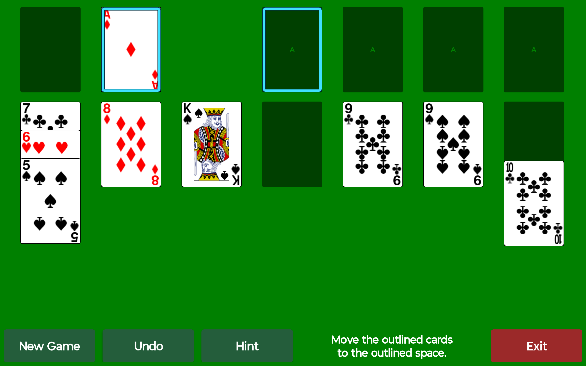

# Big Card Solitaire

Klondike solitaire for Android tablets, built to be easy to see and easy to play. The cards are big, a tap moves a card, and a Hint button shows a move when you are stuck.

Everything happens on the tablet: no account, no internet connection, no ads, no tracking. The app does not even ask for network access.



## Download

The ready-to-install app is on the [Releases page](https://github.com/Edge358/BigCardSolitaire/releases). Allow installs from unknown sources on the tablet, then open the APK.

## The game

- Draw-three Klondike, full screen in landscape.
- Large corner ranks and suit symbols, readable at arm's length.
- Tap a card, then tap where it should go. Dragging works too.
- New Game, Undo, Hint and Exit sit in a full-size bar along the bottom.
- Hint outlines a card and the place it can go, in cyan. Press again to see the next possible move. When no move is left, it says so and suggests Undo or New Game.
- Your game is saved when you leave and picks up where you were when you come back.

## Build it yourself

You need JDK 17 and the Android SDK with platform 34. Point Gradle at the SDK with a `local.properties` file containing `sdk.dir=<path to your Android SDK>`, then run:

```
gradlew assembleDebug
```

The APK is written to `app/build/outputs/apk/debug/`. Allow installs from unknown sources on the tablet, then open the APK. The app is not in any app store.

## Credits and license

Big Card Solitaire is a modified version of [SolitaireCG](https://solitairecg.sourceforge.io/) 4.1 by Curtis Gedak, which builds on the original Solitaire by Ken Magic. The game rules and card movement come from those projects; the tablet layout, big cards, tap to move, hints and save handling were changed or added here. `app/src/main/res/raw/tablet_changes.txt` lists the changes.

Released under the Apache License 2.0, like the original. See `UPSTREAM_README.txt` for the original project notes and `COPYING` for the license.
