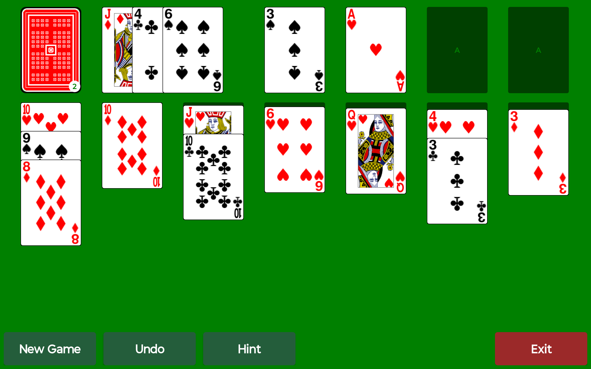
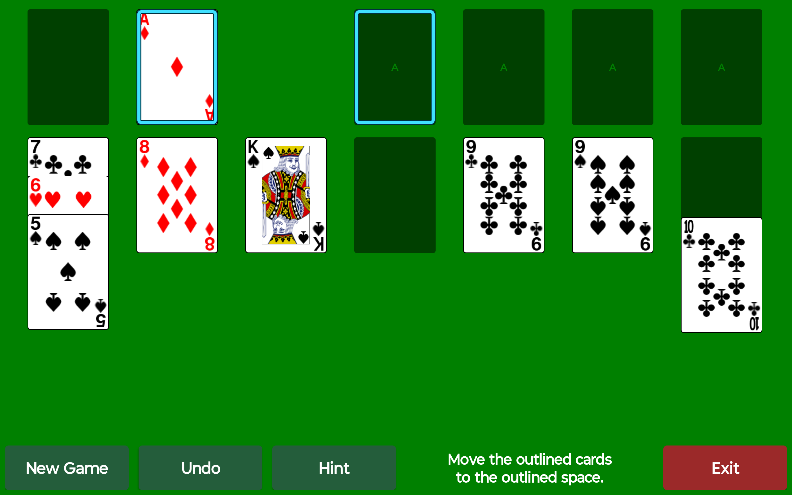

# How to play Big Card Solitaire

[Back to the project](../README.md)

Big Card Solitaire is draw-three Klondike for Android tablets. Open the app in landscape and play with a finger or stylus. It opens your saved game, or deals a new one if there is no saved game.

## Your goal

Move all 52 cards to the four foundation piles across the upper right. Each foundation starts with an Ace and builds upward in the same suit: Ace, 2, 3, through King.

The seven columns below are your working area, called the tableau. Build downward there, alternating red and black. For example, a black 9 goes on a red 10. Only a King, or a run beginning with a King, can fill an empty column. Moving the last face-up card off a column reveals the next hidden card automatically.

## Move a card or a run

| What you want to do | How to do it |
| --- | --- |
| Move by tapping | Tap a face-up card to select it, then tap the destination card or empty space. A gold outline marks your selection. |
| Move by dragging | Touch a face-up card, slide it to a legal destination, then lift your finger. |
| Move several cards together | Start with the exposed part of the first card in the run you want to move. That card and the face-up cards below it move together. |
| Cancel a selection | Tap the selected run again, or tap bare green table space. |
| Choose another card | Tap a different movable card. If it is a legal destination, the selected cards move there; otherwise it becomes your new selection. |

An illegal move does not change the deal. A dragged card returns to its pile if it cannot be placed. For precise placement, use the two-tap method.

## Draw more cards

Tap the face-down deck at the upper left to turn over up to three cards. Only the top card of the face-up pile beside it is available to play. When you move that card, the next card underneath becomes available.

When the deck is empty, tap its empty space to turn the remaining face-up cards back into the deck. You can go through the deck again without a limit. Drawing or recycling also clears a selected card.

## Hint and Undo

Tap **Hint** to outline a legal move in cyan: one outline shows the card or run, and the other shows its destination. Tap Hint again to cycle through the available moves. You still make the move yourself.

Here, tap the outlined Ace, then the outlined foundation.

If no card can move immediately but drawing can help, Hint points to the deck. If there is no legal move now or through drawing and recycling, it says **No moves available** and suggests Undo or New Game. That message can also appear after using the deck.

Hint shows legal moves, not a ranked strategy or a promise that the deal can be won.

Tap **Undo** to reverse the last move, draw or recycle. Keep tapping to go back farther. Undo also clears a selection. Your undo history is kept with the saved game.

## Extra touch shortcuts

**See a crowded stack:** press and hold a movable face-up card to expand its stack. Slide vertically to look through it. Tap a card in the expanded view to select that card and its run, then tap a destination on the table. You can also drag horizontally from the expanded stack to move the chosen run.

**Send a card home:** a quick fling of a single card can send it to a legal foundation. With the default auto-move behavior, this can start a chain of additional tableau cards moving to the foundations. Use ordinary taps or a slow drag when you want to control each move. Undo can step back through the resulting moves.

## Start over or leave

| Button | What happens |
| --- | --- |
| **New Game** | Immediately replaces the current deal with a new shuffled deal. There is no confirmation and Undo cannot bring back the previous deal. |
| **Exit** | Saves your game and closes the app. Reopening resumes that deal. |

Switching to another app also saves the game. If Exit reports a save failure, it leaves the game open so you can try again.

The Android Back key is handled as Undo when the game receives it; use the visible **Exit** button to leave. An edge swipe can temporarily reveal Android's system bars.

This edition has one Klondike table and the four visible buttons. There is no hidden menu for changing games, scoring or card artwork.
